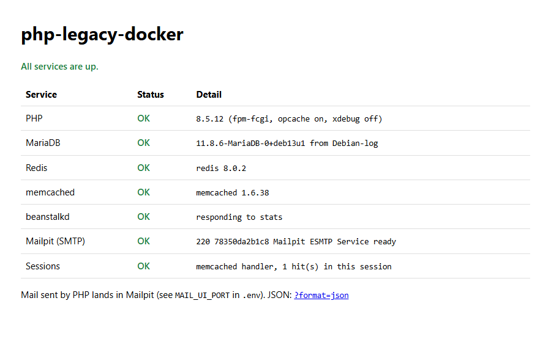

# php-legacy-docker

[](https://github.com/locorida/php-legacy-docker/actions/workflows/ci.yml)

One Docker image that replaces a Vagrant/VirtualBox development VM for a classic PHP application:
**nginx, PHP 8.5-FPM, MariaDB, Redis, memcached, beanstalkd and Mailpit**, run by supervisord.
Two PowerShell scripts start and stop it on Windows with Docker Desktop. Trusted local HTTPS
comes from mkcert.

The repository includes a small status page that checks every service, so it runs out of the box.
Point `PROJECTS_DIR` at your own code to use it for a real application.



---

## Motivation

Many long-lived PHP applications are still developed in a VM that was provisioned years ago:
Vagrant + VirtualBox, set up by a configuration-management tool that nobody maintains any more.
That setup ages badly:

- **Slow:** booting or halting the VM takes minutes, while a container is up or down in seconds.
- **Extra tooling:** every developer has to install and update VirtualBox and Vagrant, while
  Docker Desktop is usually installed already. On Windows the two also compete for the hypervisor
  (VT-x / Hyper-V).
- **Frozen versions:** moving to a new PHP release means re-provisioning the VM. Here it is one
  line in `.env` and `up.ps1 -Rebuild`, which made the move to PHP 8.5 easy to try.
- **Not reproducible:** once the provisioning server or its scripts are gone, a new VM can't be
  built. A `Dockerfile` is a complete, reviewable description of the environment.

This project is the result of that migration, rewritten as a generic template.

## Architecture: one image, not Compose

The usual Docker answer is Docker Compose with one container per service. This project uses
**one image and one container on purpose**, so it behaves like the VM it replaces.

| | One image (this project) | Compose, one container per service |
|---|---|---|
| Legacy compatibility | Every service is on real `localhost`. Code with hard-coded `127.0.0.1:11211` or a local `sendmail` works unchanged | Hostnames such as `db` or `redis` mean config or code changes, or network tricks |
| Mental model | "A machine", like the VM: one thing to start, stop and share | Several containers, a network and their start order |
| Startup | `up.ps1`, healthy in a few seconds | `docker compose up` |
| Rebuild cost | Any change to a service rebuilds the whole image (layers are cached, but still) | Rebuild or update only the affected service |
| Official images | Not used for the services; packages come from Debian | Official images per service, independently updatable |
| Scaling and isolation | None. One process supervisor, shared resources | Per-service limits, restarts and scaling |
| Best practice | Breaks "one process per container" | Follows it |

**When to choose which:** the single image is meant for local development of *legacy* code that
assumes one host. For new projects, or anything going towards production, use Compose (or
Kubernetes) with official images.

### What runs inside

| Service | Source | Listens on (in the container) | Published to host |
|---|---|---|---|
| nginx | Debian | 80, 443 | `HTTP_PORT`, `HTTPS_PORT` |
| PHP-FPM 8.5 | official `php` image | 127.0.0.1:9000 | - |
| MariaDB (LTS) | Debian | 3306 | `DB_PORT` |
| Redis | Debian | 127.0.0.1:6379 | - |
| memcached (sessions) | Debian | 127.0.0.1:11211 | - |
| beanstalkd | Debian | 127.0.0.1:11300 | - |
| Mailpit | official image (binary) | SMTP 1025, UI 8025 | `MAIL_SMTP_PORT`, `MAIL_UI_PORT` |
| Optional worker | your `WORKER_COMMAND` | - | - |

Published ports are bound to `127.0.0.1` only. PHP's `mail()` delivers to Mailpit, so no mail
ever leaves your machine. PHP extensions: bcmath, calendar, exif, gd, gettext, igbinary, intl,
memcached, mysqli, opcache, pcntl, pdo_mysql, redis, soap, sockets, xdebug, zip. Composer is included.

```
Windows host                       container (supervisord)
-----------------------------      -----------------------------------------------
PROJECTS_DIR  --bind mount-->      /var/www/html      nginx -> php-fpm
DATA_DIR      --bind mount-->      /srv/data                   |-> MariaDB  (volume <APP_NAME>-db)
certs/        --bind mount-->      /certs (ro)                 |-> Redis    (volume <APP_NAME>-redis)
                                                               |-> memcached, beanstalkd
127.0.0.1:8080/8443/3306/8025 ->   80/443/3306/8025            '-> mail() -> Mailpit
```

## Requirements

- Windows 10/11 with **Docker Desktop** (WSL2 backend)
- PowerShell 5.1 or 7
- Optional: Git Bash, to run the smoke test locally

Linux and macOS work as well: run the `docker build` / `docker run` commands from the CI workflow.

## Quickstart

```powershell
git clone https://github.com/locorida/php-legacy-docker.git
cd php-legacy-docker
.\scripts\setup-certs.ps1   # optional: trusted HTTPS via mkcert (one-time)
.\up.ps1                    # creates .env, builds the image (first time: a few minutes), starts
```

Open <http://app.localhost:8080> or <https://app.localhost:8443>. You should see the status page
with every service marked OK. Mailpit is at <http://localhost:8025>.

```powershell
.\down.ps1                  # stop (data is kept)
```

If script execution is blocked: `powershell -ExecutionPolicy Bypass -File .\up.ps1`.

### Script options

| Command | Effect |
|---|---|
| `up.ps1` | Start. Builds the image if it doesn't exist yet |
| `up.ps1 -Rebuild` | Rebuild the image (pulls newer base images) and replace the container |
| `up.ps1 -Recreate` | Replace the container, e.g. after editing `.env` |
| `up.ps1 -Watch` | Also start the file watcher (see [Performance](#performance-on-windows)) |
| `down.ps1` | Stop container and watcher |
| `down.ps1 -Remove` | Also remove the container (volumes stay) |
| `down.ps1 -Purge` | Also delete the data volumes (asks first) |

## Configuration

All settings live in `.env`, which `up.ps1` creates from [`.env.example`](.env.example) on first run.
After a change, run `up.ps1 -Recreate` (or `-Rebuild` for `PHP_IMAGE`).

| Variable | Default | Purpose |
|---|---|---|
| `APP_NAME` | `php-legacy` | Container name; image `<APP_NAME>:local`; volume prefix |
| `APP_DOMAIN` | `app.localhost` | Host name for the certificate. `*.localhost` needs no hosts entry |
| `PROJECTS_DIR` | `./app` | Your code, mounted at `/var/www/html` |
| `DOCUMENT_ROOT` | `/var/www/html/public` | nginx web root (container path) |
| `DATA_DIR` | `./data` | Writable app data, mounted at `/srv/data`. Empty = no mount |
| `HTTP_PORT` / `HTTPS_PORT` | `8080` / `8443` | Web ports on the host |
| `DB_PORT` | `3306` | MariaDB on the host |
| `MAIL_SMTP_PORT` / `MAIL_UI_PORT` | `1025` / `8025` | Mailpit |
| `DB_NAME` / `DB_USER` / `DB_PASSWORD` | `app` / `app` / `app` | Created on first start. Local use only |
| `DB_BUFFER_POOL` | `256M` | InnoDB buffer pool |
| `DB_SQL_MODE` | `NO_ENGINE_SUBSTITUTION` | Lenient, as many legacy apps expect. Tighten when ready |
| `PHP_IMAGE` | *(empty = PHP 8.5)* | Base image, e.g. `php:8.4-fpm-trixie` |
| `TZ` | `UTC` | Container and PHP time zone |
| `XDEBUG_MODE` | `off` | `debug`, `develop`, `coverage`. Debug sessions start on trigger |
| `OPCACHE_VALIDATE_TIMESTAMPS` | `1` | `0` = faster, requires the watcher |
| `WORKER_COMMAND` | *(empty)* | Long-running worker (queue consumer etc.), supervised as `www-data` |

**Seed data:** put `*.sql` or `*.sql.gz` files into `initdb/`. They are imported into `DB_NAME`
when the database volume is created for the first time (`down.ps1 -Purge`, then `up.ps1`).

**Connecting from the host:** `mysql -h 127.0.0.1 -P 3306 -u app -p`. The MariaDB `root` user
only works via socket inside the container: `docker exec -it php-legacy mariadb`.

### HTTPS

[`scripts/setup-certs.ps1`](scripts/setup-certs.ps1) downloads a pinned mkcert release,
**verifies its SHA-256** before running it, installs a per-user local CA (no admin rights needed)
and issues a certificate for `APP_DOMAIN`, `*.APP_DOMAIN`, `localhost` and `127.0.0.1` into `certs/`.
Run it again at any time; it renews certificates that expire within 30 days.

The mkcert binary is deliberately not committed. It installs a root CA, so a swapped `.exe` in a
repository would run on every contributor's machine and go unnoticed in code review. Only its
checksum is committed, where every change is visible in a diff.

Without `certs/cert.pem`, the container generates a self-signed certificate, so HTTPS works
(with a browser warning) and CI needs no extra setup.

## Performance on Windows

Code on the Windows file system (`C:\...`) reaches the container through a bind mount, and every
file stat over that mount is slow. Legacy apps often include hundreds of files per request, and
by default OPcache checks each of them for changes.

Two ways out:

1. **`OPCACHE_VALIDATE_TIMESTAMPS=0` + `up.ps1 -Watch`.** PHP stops checking files. A small
   PowerShell watcher (`scripts/watch-reload.ps1`) gracefully reloads PHP-FPM, and restarts
   the worker, whenever a `.php` file changes. On large code bases this saves a noticeable share
   of every request. Measure it on yours.
2. **Keep the code inside WSL2** (`\\wsl$\...`) and set `PROJECTS_DIR` to that path. All file
   access is native and the watcher becomes unnecessary. Your IDE then works over WSL.

## Troubleshooting

| Symptom | Cause / fix |
|---|---|
| `Bind for 127.0.0.1:3306 failed: port is already allocated` | A local MySQL, the old VM or another container uses the port. Change `DB_PORT` (or other `*_PORT`) in `.env`, then `up.ps1 -Recreate` |
| Container stays `starting` / `unhealthy` | `docker logs php-legacy` shows which service fails. `docker exec php-legacy supervisorctl status` |
| `.sh` scripts fail with `/bin/sh^M: bad interpreter` | Files were checked out with CRLF. `.gitattributes` prevents this. After cloning with an old Git config: `git rm --cached -r . && git reset --hard` |
| Code changes don't show up | `OPCACHE_VALIDATE_TIMESTAMPS=0` without a running watcher. Start `up.ps1 -Watch` or `docker exec php-legacy supervisorctl signal USR2 php-fpm` |
| Git Bash: `docker exec ... cat /var/www/...` reads `C:/Program Files/Git/var/www/...` | MSYS path conversion. Prefix the command with `MSYS_NO_PATHCONV=1` |
| Browser warns about the certificate | Run `scripts\setup-certs.ps1`, then `up.ps1 -Recreate`. In Firefox, set `security.enterprise_roots.enabled = true` |
| Changed `DB_NAME` / `DB_USER` / `DB_PASSWORD` has no effect | They are only applied when the volume is empty. Change them in SQL, or `down.ps1 -Purge` |
| MariaDB complains about crashed tables after a stop | The container was killed too early. The scripts use a 120 s stop timeout. Never use `docker kill` |
| Docker Desktop uses too much RAM | Limit WSL2 in `%USERPROFILE%\.wslconfig` (`[wsl2]` / `memory=8GB`), then `wsl --shutdown` |
| `up.ps1` says Docker is not reachable | Start Docker Desktop and wait until the engine runs |

## CI

[`.github/workflows/ci.yml`](.github/workflows/ci.yml) builds the image for PHP 8.5 and 8.4 and
runs [`tests/smoke.sh`](tests/smoke.sh) against the running container. The test checks that the
container becomes healthy, HTTP and HTTPS return 200, the PHP version is right, MariaDB is
reachable with the app user, every service on the status page is OK and `mail()` arrives in
Mailpit. The last step checks that MariaDB shuts down cleanly on `docker stop`.

Run the same test locally (Git Bash): `bash tests/smoke.sh php-legacy 8080 8443 8.5`

## Project layout

| Path | Content |
|---|---|
| `Dockerfile` | The image |
| `rootfs/` | Config files copied 1:1 into the image (nginx, PHP, PHP-FPM, MariaDB, supervisord, entrypoint) |
| `app/` | Demo app (status page). Replace it, or point `PROJECTS_DIR` elsewhere |
| `up.ps1`, `down.ps1` | Start and stop on Windows |
| `scripts/setup-certs.ps1` | mkcert setup with checksum verification |
| `scripts/watch-reload.ps1` | File watcher for `OPCACHE_VALIDATE_TIMESTAMPS=0` |
| `scripts/common.ps1` | Shared PowerShell helpers |
| `tests/smoke.sh` | Smoke test (CI and local) |

## License

[MIT](LICENSE)
